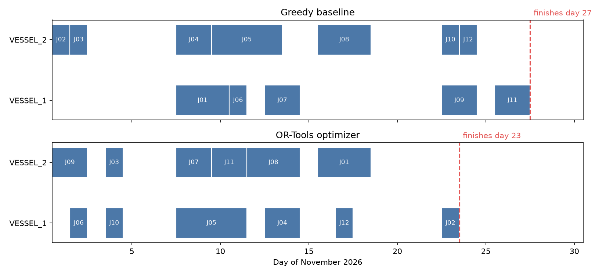

# Offshore Vessel Scheduling Optimizer

A Python decision-support tool that schedules offshore jobs across a small vessel fleet around weather windows, and compares a simple first-come-first-served plan with an optimized plan built using **Google OR-Tools (CP-SAT)**.

## Result

| Approach | All jobs finished by |
|---|---|
| Greedy baseline (jobs in order, earliest available vessel) | **Day 27** |
| OR-Tools optimizer | **Day 23** |

**The optimizer finishes 4 days earlier (about 15% shorter)**, using the same jobs, vessels and weather.



## The problem

- **12 offshore jobs** (1–4 days each) must be completed within a **30-day** forecast window.
- **2 vessels** with different safe operating limits: VESSEL_1 can work in waves up to **2.0 m**, VESSEL_2 up to **2.5 m**.
- A job can only run on consecutive days that are **calm enough for the vessel doing it**.
- Each vessel can do **one job at a time**.
- **Goal:** finish all the jobs as early as possible.

## How it works

1. **Data cleaning** (`clean_weather.py`): fixes messy forecast data: mixed date formats, wave heights in feet, missing readings, impossible values (e.g. -1.0 m, 99.0 m) and duplicate rows. Unknown sea states are treated as **not workable**, for safety.
2. **Anonymization** (`anonymize.py`): replaces client, vessel and operator names with codes (e.g. `CLIENT_1`, `VESSEL_1`) to protect confidentiality.
3. **Workable days** (`baseline.py`): for each vessel, works out which days are too rough, using that vessel's wave limit from the data (no hard-coded limits).
4. **Greedy baseline** (`baseline.py`): takes jobs in the listed order and gives each to whichever vessel can start it earliest.
5. **Optimizer** (`optimizer.py`): describes the problem to the OR-Tools CP-SAT solver:
   - *Decisions:* which vessel does each job, and on which day
   - *Rules:* each job on exactly one vessel, only on calm days for that vessel, no double-booking
   - *Goal:* minimize the day the last job finishes
6. **Comparison chart** (`compare.py`): draws both schedules as timelines.

## Project structure

```
data/
  jobs.csv, vessels.csv           original input data (fictional)
  jobs_anon.csv, vessels_anon.csv anonymized data
  weather_raw.csv                 messy forecast (deliberate errors)
  weather_cleaned.csv             cleaned forecast
  baseline_schedule.csv           greedy result
  optimized_schedule.csv          optimizer result
generate_weather.py   creates a 30-day sample forecast
clean_weather.py      data cleaning
anonymize.py          anonymization
baseline.py           workable days + greedy baseline
optimizer.py          OR-Tools CP-SAT model
compare.py            comparison chart
test_clean_weather.py pytest tests for the cleaning functions
```

## How to run

```bash
python -m venv .venv
.venv\Scripts\activate          # Windows
pip install -r requirements.txt

python clean_weather.py
python baseline.py
python optimizer.py
python compare.py
pytest -v
```

## Tech stack

Python · pandas · Google OR-Tools (CP-SAT) · matplotlib · pytest

## Next steps

- A simple web page (Streamlit) to upload a forecast and run the optimizer
- "What if" scenarios: rougher seas, more vessels, tighter deadlines
- A cost measure based on vessel day rates
- More tests for the scheduling logic

*All company, vessel and client names in the data are fictional.*